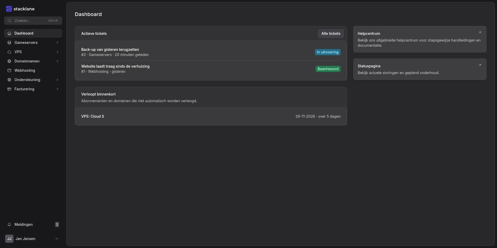

<br>
<p align="center">
  <a href="https://stacklane.io">
    
  </a>
</p>
<h1 align="center">
  Stacklane
</h1>

<div align="center">
  <h3>The customer panel for hosting companies</h3>
  <p>One place for your customers' game servers, VPS, domains, web hosting, support tickets and invoices. Fast, light and on your own server.</p>
</div>

<h4 align="center">
  <a href="https://stacklane.io">Website</a> ·
  <a href="https://stacklane.io/docs/getting-started/introduction">Documentation</a> ·
  <a href="https://demo.stacklane.io">Live demo</a> ·
  <a href="https://stacklane.io/releases/">Releases</a>
</h4>

<div align="center">

  [](https://github.com/boterberg/stacklane/releases)
  [](https://github.com/boterberg/stacklane/actions/workflows/ci.yml)

</div>

<div align="center">
  
</div>

## Getting started

#### Installation and documentation

How to install and configure Stacklane is described in the [documentation](https://stacklane.io/docs/installation/install). In short, on Debian or Ubuntu:

```sh
curl -fsSLO https://raw.githubusercontent.com/boterberg/stacklane/main/packaging/install.sh
sudo sh install.sh
```

#### Requirements

- Debian 12 or newer, or Ubuntu 24.04 or newer (amd64)
- PostgreSQL 15 or newer
- A reverse proxy for HTTPS, such as Caddy

## What is Stacklane?

Stacklane is the panel your customers log in to. They see their services, open support tickets, follow up on invoices and manage their account, in a calm interface that works the same on a phone as on a desktop.

It is one Rust binary with the React panel built in, backed by PostgreSQL and shipped as a Debian package. Releases are built on GitHub and installed with `apt`.

Stacklane is early. Accounts, the dashboard and support tickets work today; billing, VPS, game servers, domains and web hosting follow in the next releases. See the [releases](https://stacklane.io/releases/) for what changed in each version.

## Development

```sh
sh scripts/dev-db.sh
cp .env.example .env
cargo run
```

```sh
cd web
npm install
npm run dev
```

The panel runs on http://localhost:5173. The website and documentation live in `docs/` and run with `npm run dev` in that folder. More in [the contributor guide](https://stacklane.io/docs/contribute/how-to-help).
